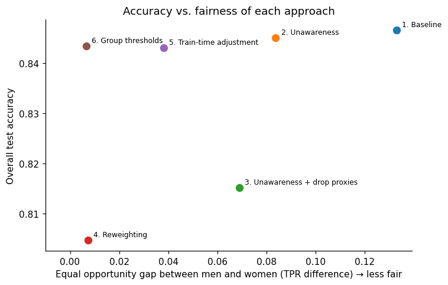

# Income Prediction & Fairness Analysis

**Question:** Can we predict whether someone earns more than $50K a year, and does the model work equally well for men and women and across racial groups?

Models like this are used in lending, hiring and marketing. A model can look accurate overall while systematically failing one group. This project builds an income classifier from scratch in NumPy, audits it for group-level gaps, and tests six ways to reduce them.

## Results

- **Baseline model:** 84.7% test accuracy (vs 76.4% for always predicting "<=50K"), ROC AUC 0.90. The from-scratch implementation matches scikit-learn on 99% of predictions.
- **Hidden gap:** the model is *more* accurate for women (93% vs 81%), yet it recognizes only **47% of high-earning women vs 60% of high-earning men**, a 13-point equal-opportunity gap.
- **"Just drop the sex column" doesn't work:** the other features predict sex with an AUC of 0.93, so the gap only shrinks to 8 points.
- **Targeted fixes work:** adjusting for sex during training cuts the gap to **4 points**, and group-specific thresholds close it (**0.7 points**), each for only **0.4 points of accuracy**.



| Approach | Accuracy | TPR women | TPR men | Gap |
|---|---|---|---|---|
| Baseline | 0.847 | 0.47 | 0.60 | 0.133 |
| Drop `sex` & `race` | 0.845 | 0.51 | 0.59 | 0.084 |
| + drop proxy features | 0.815 | 0.36 | 0.43 | 0.069 |
| Reweighting | 0.805 | 0.81 | 0.80 | 0.007 |
| **Train-time adjustment** (sex not used at prediction) | **0.843** | 0.57 | 0.54 | **0.038** |
| **Group thresholds** (sex used at decision time) | **0.843** | 0.59 | 0.58 | **0.007** |

TPR = share of people truly earning >50K that the model recognizes. Gap = TPR difference between men and women.

## Approach

| Notebook | What it does |
|---|---|
| [01 Data cleaning & EDA](notebooks/01_data_cleaning_eda.ipynb) | Clean the raw census files, treat non-random missingness, explore income gaps by group, detect proxy features |
| [02 Logistic regression from scratch](notebooks/02_logistic_regression_from_scratch.ipynb) | Mini-batch gradient descent with L2 and sample weights; verified against scikit-learn; tuned with stratified CV |
| [03 Fairness evaluation & mitigation](notebooks/03_fairness_evaluation.ipynb) | Per-group audit with bootstrap confidence intervals, proxy analysis, six mitigation strategies compared |

Reusable code lives in [`src/`](src/): the [logistic regression class](src/logistic_regression.py), the [feature pipeline](src/features.py) and the [group-fairness metrics](src/metrics.py).

## Key findings

1. **Overall accuracy hides unfairness.** Per-group true positive rates showed a gap that accuracy pointed in the opposite direction.
2. **Fairness through unawareness fails** when proxies exist (`relationship` = Husband/Wife almost reveals sex).
3. **Removing predictive features hurts everyone.** Dropping the proxies lowered TPR for both sexes ("levelling down").
4. **The fairness metric is a business and legal choice.** Reweighting equalizes TPR but widens the selection-rate gap, and with base rates of 30% vs 11% both cannot be equal at once.
5. **Recommendation:** use group thresholds where the law allows sex at decision time; otherwise use train-time adjustment. Monitor per-group metrics either way.

## Data

[UCI Adult (Census Income)](https://archive.ics.uci.edu/dataset/2/adult), 48,842 people from the 1994 US Census, CC BY 4.0. Details, column descriptions and loading quirks: [data/README.md](data/README.md).

**Limitations:** 1994 data with a $50K threshold not adjusted for inflation; one train/test split, with wide confidence intervals for the smallest race groups; binary sex variable. See the end of notebook 3.

## Run it yourself

```bash
pip install -r requirements.txt
python data/download_data.py
jupyter lab
```

Run the notebooks in order from inside the `notebooks/` folder. Notebook 1 writes the cleaned data that notebooks 2 and 3 use.

## Tech stack

Python · NumPy · pandas · scikit-learn (for verification and metrics) · Matplotlib · Jupyter
